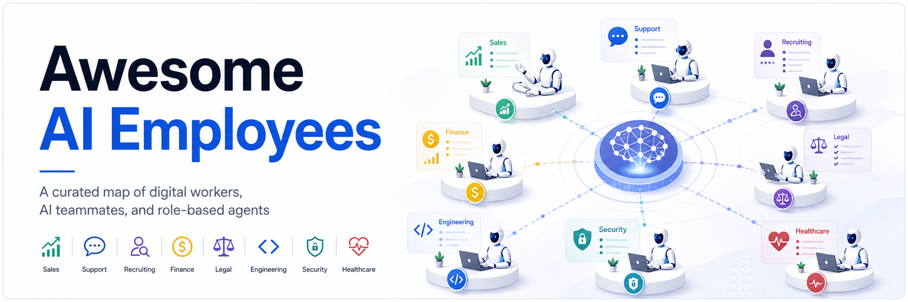

# Awesome AI Employees

Curated list of companies selling **AI employees**, **digital workers**, **role-based agents**, **AI teammates**, and AI CxO-style products.

The focus is on products that are positioned as doing a recurring job or business function, not merely providing a generic chatbot, model API, or one-off AI feature.

Last updated: 2026-05-20  
Companies tracked: 101  
Categories: 10

## Curation Criteria

Included companies should meet at least one of these bars:

- The company explicitly sells an "AI employee", "digital worker", "AI teammate", "AI agent", or named role-based AI worker.
- The product is positioned around an ongoing business function, such as sales development, customer support, recruiting, accounting, legal review, software engineering, security operations, or healthcare administration.
- The product can complete work across a workflow, not just answer questions in a chat window.

Excluded by default:

- Generic LLM APIs, model providers, or chatbot builders without a role-based worker angle.
- Single-feature AI add-ons that do not own a recurring workflow.
- Internal-only agents with no public product page.
- Companies where the AI positioning cannot be verified from a public source.

Suggestions are welcome through GitHub issues or pull requests. See [CONTRIBUTING.md](CONTRIBUTING.md) for the submission checklist.

<!-- LISTING:START -->
<!-- This section is generated from data/companies.csv. Do not edit it by hand. -->

## Contents

- [Curation Criteria](#curation-criteria)
- [Domain Counts](#domain-counts)
- [Horizontal AI workforce and automation platforms](#horizontal-ai-workforce-and-automation-platforms)
- [Sales, SDR, and revenue agents](#sales-sdr-and-revenue-agents)
- [Marketing, growth, and AI CMO agents](#marketing-growth-and-ai-cmo-agents)
- [Customer support, CX, and ecommerce agents](#customer-support-cx-and-ecommerce-agents)
- [Recruiting and HR agents](#recruiting-and-hr-agents)
- [Finance, accounting, and back-office agents](#finance-accounting-and-back-office-agents)
- [Legal and compliance agents](#legal-and-compliance-agents)
- [Software engineering, IT, and SRE agents](#software-engineering-it-and-sre-agents)
- [Security and SOC agents](#security-and-soc-agents)
- [Healthcare admin and clinical operations agents](#healthcare-admin-and-clinical-operations-agents)
- [Data](#data)
- [Contributing](#contributing)
- [Roadmap](#roadmap)
- [License](#license)

## Domain Counts

- Horizontal AI workforce and automation platforms: 13
- Sales, SDR, and revenue agents: 12
- Marketing, growth, and AI CMO agents: 12
- Customer support, CX, and ecommerce agents: 15
- Recruiting and HR agents: 9
- Finance, accounting, and back-office agents: 10
- Legal and compliance agents: 10
- Software engineering, IT, and SRE agents: 12
- Security and SOC agents: 4
- Healthcare admin and clinical operations agents: 4

Total: 101

## Horizontal AI workforce and automation platforms

| # | Company | AI employee angle | Link |
|---:|---|---|---|
| 1 | Relevance AI | No-code AI workforce and multi-agent teams for business functions. | https://relevanceai.com/workforce |
| 2 | Lindy | AI employees and custom agents for sales, support, ops, inbox, and scheduling work. | https://www.lindy.ai/ |
| 3 | Teammates.ai | Named AI teammates for support, sales, and recruiting. | https://teammates.ai/ |
| 4 | Beam AI | Enterprise AI agent platform for business-process automation. | https://beam.ai/ai-agents |
| 5 | Gumloop | AI automation and agent builder for operational workflows. | https://www.gumloop.com/ |
| 6 | Zapier Agents | Agents that execute work across Zapier's integration graph. | https://zapier.com/agents |
| 7 | CrewAI | Enterprise platform for operating teams of AI agents. | https://www.crewai.com/ |
| 8 | Cassidy | AI agents that operate inside a company's existing tools and knowledge. | https://www.cassidyai.com/ |
| 9 | Bardeen | Browser and app automation agents for repetitive knowledge work. | https://www.bardeen.ai/ |
| 10 | Sistava | Sistava is an AI agent orchestration platform for deploying and operating multiple AI agents that run your entire business across sales, marketing, finance, and customer support, reachable through Slack, WhatsApp, email, voice, Telegram, API, MCP, A2A, and webhooks, with full computer use on your own OS. | https://sistava.com |
| 11 | Orkas | Open-source, local-first desktop AI workforce coordinated by a Commander through one chat. | https://github.com/Orkas-AI/Orkas |
| 12 | Deliberate | Eleven named AI agents for ecommerce brands across paid media, email, support, operations, and finance, sharing one data layer. | https://deliberatestudio.com/ |
| 13 | AI Employees (Reinventing.AI) | Open-source AI employees: eight scheduled business roles with 60 routines for GTM, SEO, ads, sales, and support, run on your own desktop agent. | https://github.com/markfulton/ai-employees |

## Sales, SDR, and revenue agents

| # | Company | AI employee angle | Link |
|---:|---|---|---|
| 14 | Artisan | Ava, an AI BDR / sales employee for outbound prospecting and meeting booking. | https://www.artisan.co/ |
| 15 | 11x | Alice and Julian, digital workers for outbound sales and phone qualification. | https://www.11x.ai/ |
| 16 | AiSDR | AI SDR agent for prospecting, outreach, follow-up, and booked meetings. | https://aisdr.com/ |
| 17 | Qualified | Piper, an AI SDR for inbound pipeline across website and email. | https://www.qualified.com/ |
| 18 | Regie.ai | AI sales agents for prospecting, sequence generation, and rep workflows. | https://www.regie.ai/ |
| 19 | Salesforge | Agent Frank, an AI SDR for outbound campaigns and follow-ups. | https://www.salesforge.ai/agent/frank |
| 20 | Unify | GTM agents that research accounts, qualify signals, and trigger outreach plays. | https://www.unifygtm.com/ |
| 21 | Clay | AI research and enrichment agents for outbound and GTM engineering workflows. | https://www.clay.com/ |
| 22 | Persana AI | AI sales prospecting agents for lead research, enrichment, and workflow automation. | https://persana.ai/ |
| 23 | Nooks | AI sales assistant for dialing, prospecting, coaching, and sales workflow automation. | https://www.nooks.ai/ |
| 24 | SalesCloser AI | Voice AI sales agents for discovery, qualification, and closing conversations. | https://salescloser.ai/ |
| 25 | Bland | AI phone agents for sales calls, qualification, scheduling, and follow-up. | https://www.bland.ai/ |

## Marketing, growth, and AI CMO agents

| # | Company | AI employee angle | Link |
|---:|---|---|---|
| 26 | The AI CMO | Autonomous marketing agent for strategy, content, publishing, and analytics. | https://theaicmo.com/ |
| 27 | Finsi | AI CMO for ecommerce brands, focused on growth priorities and campaign execution. | https://www.finsi.ai/ |
| 28 | Tixi | AI Chief Marketing Officer positioned as an always-on marketing leader. | https://www.tixi.ai/ |
| 29 | Maesto | Autonomous marketing agents for B2C campaign planning, launch, and optimization. | https://maesto.ai/ |
| 30 | Prago | Autonomous marketing agent that executes SEO, paid ads, social, content, and PR. | https://prago.io/ |
| 31 | Autom | AI marketing agent for social content, ad creatives, campaigns, and brand growth. | https://useautom.ai/ |
| 32 | OpenAnalyst | Autonomous marketing agents for planning, creating, and optimizing campaigns. | https://www.openanalyst.com/ |
| 33 | Jasper | Marketing AI agents that act as brand-aware marketing teammates. | https://www.jasper.ai/agents |
| 34 | Copy.ai | GTM AI platform with agents for sales and marketing workflows. | https://www.copy.ai/ |
| 35 | AirOps | AI agents and workflows for SEO, content, and growth operations. | https://www.airops.com/ |
| 36 | Omneky | AI agents for ad creative generation, testing, and campaign optimization. | https://www.omneky.com/ |
| 37 | Teamday | AI marketing team: an AI CMO sets one measurable goal and runs writer, SEO, and analytics agents; you approve every draft. | https://www.teamday.ai/ai-employees |

## Customer support, CX, and ecommerce agents

| # | Company | AI employee angle | Link |
|---:|---|---|---|
| 38 | Sierra | AI agents for customer experience across chat, SMS, email, voice, and more. | https://sierra.ai/ |
| 39 | Decagon | AI customer concierge agents for chat, email, and voice workflows. | https://decagon.ai/ |
| 40 | Ada | AI customer service agents that autonomously resolve support conversations. | https://www.ada.cx/ |
| 41 | Intercom | Fin, an AI customer agent for service, sales, and ecommerce conversations. | https://www.intercom.com/fin |
| 42 | Zendesk | AI agents for automated customer service resolution inside Zendesk. | https://www.zendesk.com/service/ai/ai-agents/ |
| 43 | Forethought | Multi-agent customer support platform for resolution, classification, and copilot workflows. | https://forethought.ai/ |
| 44 | Maven AGI | Enterprise AI agent platform for support and customer experience. | https://www.mavenagi.com/ |
| 45 | Parloa | AI agents for contact-center voice and chat automation. | https://www.parloa.com/ |
| 46 | PolyAI | Voice AI agents for enterprise customer service calls. | https://poly.ai/ |
| 47 | Cognigy | AI agents for enterprise contact centers and customer service automation. | https://www.cognigy.com/ |
| 48 | Kore.ai | AI agents and virtual assistants for customer and employee service. | https://kore.ai/ |
| 49 | Yellow.ai | AI agents for customer service, employee service, and contact-center automation. | https://yellow.ai/ |
| 50 | Gorgias | AI Agent for ecommerce customer support automation. | https://www.gorgias.com/ai-agent |
| 51 | Siena AI | Autonomous customer service agents for commerce brands. | https://www.siena.cx/ |
| 52 | Workforce Wave | AI voice receptionist that answers inbound calls 24/7, books appointments, and captures leads for small and mid-sized businesses. | https://www.workforcewave.com/ |

## Recruiting and HR agents

| # | Company | AI employee angle | Link |
|---:|---|---|---|
| 53 | ConverzAI | AI recruiter and conversational recruiting automation. | https://www.converzai.com/ |
| 54 | Paradox | Olivia, a conversational AI assistant for high-volume hiring workflows. | https://www.paradox.ai/ |
| 55 | Belris | Autonomous AI recruiter for job analysis, candidate matching, outreach, and scheduling. | https://mybelris.com/ |
| 56 | Placewise AI | Autonomous AI recruiter for screening and first-round hiring workflows. | https://www.placewise.ai/ |
| 57 | Renate | Autonomous AI recruiter for sourcing, resume screening, voice interviews, and shortlists. | https://renate.in/ |
| 58 | Shift | Anna, an AI recruiting agent for sourcing, outreach, interview support, and scoring. | https://www.tryshift.ai/ |
| 59 | AiTento | AyeBo, a multi-agent AI recruiter for sourcing, screening, and hiring orchestration. | https://aitento.com/ |
| 60 | Adison.ai | AI recruitment team with agents for sourcing, selection, and candidate matching. | https://www.adison.ai/ |
| 61 | Fountain | AI Recruiter for frontline and high-volume hiring. | https://www.fountain.com/airecruiter |

## Finance, accounting, and back-office agents

| # | Company | AI employee angle | Link |
|---:|---|---|---|
| 62 | Basis | AI agents for accounting firms, including reconciliations, journal entries, and summaries. | https://www.getbasis.ai/ |
| 63 | Numeric | Accounting AI for close management, variance analysis, and accounting workflows. | https://www.numeric.io/ |
| 64 | Vic.ai | Agentic finance partners and autonomous accounts payable workflows. | https://www.vic.ai/ |
| 65 | Auditoria | AI-enabled finance agents for AR, AP, collections, and finance operations. | https://www.auditoria.ai/ |
| 66 | Digits | AI accounting agents built on an autonomous general ledger. | https://digits.com/ |
| 67 | Nominal | Agentic AI platform that runs accounting workflows. | https://nominal.so/ |
| 68 | Ledgent AI | Autonomous finance agents for AP, AR, close, and finance operations. | https://www.ledgent.ai/ |
| 69 | ProcIndex | AI accounting team for AP, AR, reconciliation, close, and vendor workflows. | https://procindex.com/ |
| 70 | Finlessly | Autonomous CFO agent for audit, accounting automation, and finance analysis. | https://www.finlessly.ai/ |
| 71 | Synthetic | AI bookkeeping agent for startup accounting workflows. | https://synthetic.ai/ |

## Legal and compliance agents

| # | Company | AI employee angle | Link |
|---:|---|---|---|
| 72 | Harvey | Legal AI agents for research, drafting, analysis, and practice-specific workflows. | https://www.harvey.ai/agents |
| 73 | Legora | Collaborative legal AI platform with agentic workflows for lawyers. | https://legora.com/ |
| 74 | Spellbook | Legal AI agent for contract drafting, redlining, and multi-document review. | https://spellbook.com/ |
| 75 | Robin AI | Contract AI assistant for legal teams and contract review workflows. | https://www.robinai.com/ |
| 76 | Thomson Reuters | CoCounsel, legal AI for research, drafting, review, and professional workflows. | https://legal.thomsonreuters.com/en/products/cocounsel |
| 77 | LexisNexis | Lexis+ AI for legal research, drafting, and legal workflow assistance. | https://www.lexisnexis.com/en-us/products/lexis-plus-ai.page |
| 78 | Luminance | Legal AI agents for contract review, negotiation, and legal process automation. | https://www.luminance.com/ |
| 79 | Workday | Contracts Agent (formerly Evisort) for contract review, negotiation, and lifecycle management. | https://www.workday.com/en-us/ai-agents/finance/contracts.html |
| 80 | Ironclad | AI-powered contract lifecycle management and legal workflow automation. | https://ironcladapp.com/ |
| 81 | Norm Ai | Legal and compliance AI agents that encode laws, policies, and regulatory judgment. | https://www.norm.ai/ |

## Software engineering, IT, and SRE agents

| # | Company | AI employee angle | Link |
|---:|---|---|---|
| 82 | Cognition | Devin, an AI software engineer for coding, maintenance, migration, and incident tasks. | https://devin.ai/ |
| 83 | Factory | Droids, AI software-engineering agents for SDLC tasks. | https://www.factory.ai/ |
| 84 | Cosine | Genie, an AI software engineering agent for planning, coding, testing, and collaboration. | https://cosine.sh/ |
| 85 | Cursor | Agentic coding environment for software development tasks. | https://cursor.com/ |
| 86 | Replit | Replit Agent for building and modifying software from natural-language requests. | https://replit.com/agent |
| 87 | Lovable | AI software builder that turns prompts into applications. | https://lovable.dev/ |
| 88 | StackBlitz | Bolt.new, an AI app-building agent in the browser. | https://bolt.new/ |
| 89 | Vercel | v0, an AI UI and app generation product for frontend development. | https://v0.dev/ |
| 90 | GitHub | Copilot coding agent for issue-to-PR software engineering work. | https://github.com/features/copilot |
| 91 | CodeRabbit | AI code review agent for pull requests, IDEs, and CLI workflows. | https://www.coderabbit.ai/ |
| 92 | Ciroos | AI SRE teammate for incident investigation, anomaly analysis, and autonomous operations. | https://ciroos.ai/ |
| 93 | Resolve AI | AI SRE for alert triage, root-cause analysis, and incident investigation. | https://resolve.ai/product/ai-sre |

## Security and SOC agents

| # | Company | AI employee angle | Link |
|---:|---|---|---|
| 94 | Dropzone AI | AI SOC analyst for autonomous alert investigation and threat hunting. | https://www.dropzone.ai/ |
| 95 | Prophet Security | AI SOC analyst for security alert investigation and response. | https://www.prophetsecurity.ai/ai-soc-analyst |
| 96 | Torq | Socrates, an agentic AI SOC analyst and orchestrator for SecOps workflows. | https://torq.io/socrates/ |
| 97 | XBOW | Autonomous AI penetration tester for offensive security work. | https://xbow.com/ |

## Healthcare admin and clinical operations agents

| # | Company | AI employee angle | Link |
|---:|---|---|---|
| 98 | Hippocratic AI | Healthcare voice AI agents for non-diagnostic patient-facing workflows. | https://hippocraticai.com/ |
| 99 | Infinitus | Healthcare AI agents for patient, provider, and payer communications. | https://www.infinitus.ai/ |
| 100 | Hyro | Healthcare AI agents for call centers, scheduling, patient access, and routing. | https://www.hyro.ai/ |
| 101 | Tennr | Healthcare AI agents for document, referral, and back-office workflows. | https://www.tennr.com/ |

<!-- LISTING:END -->

## Data

The source of truth is [data/companies.csv](data/companies.csv). Generated exports:

- [README.md](README.md) listing sections
- [data/companies.json](data/companies.json)

Run `make generate` after editing the CSV. Run `make check` before committing.

## Contributing

This list is intentionally selective. A good submission includes the company name, product page, category, and one sentence explaining the AI employee or recurring-workflow angle.

Before submitting, check that the company has a public product page and that the AI worker positioning is visible there. See [CONTRIBUTING.md](CONTRIBUTING.md) for the full checklist.

## Roadmap

Planned additions before a wider public launch:

- Link health checks.
- Recent additions section.
- More evidence notes for each listing.

## License

This work is licensed under the [Creative Commons Attribution 4.0 International License](LICENSE).
