# Awesome AI Employees

Curated list of companies selling **AI employees**, **digital workers**, **role-based agents**, **AI teammates**, and AI CxO-style products.

The focus is on products that are positioned as doing a recurring job or business function, not merely providing a generic chatbot, model API, or one-off AI feature.

Last updated: 2026-10-20\
Companies tracked: 131\
Categories: 14

## Curation Criteria

Included companies should meet at least one of these bars:

- The company explicitly sells an "AI employee", "digital worker", "AI teammate", "AI agent", or named role-based AI worker.
- The product is positioned around an ongoing business function, such as sales development, customer support, recruiting, accounting, legal review, software engineering, security operations, or healthcare administration.
- The product can complete work across a workflow, not just answer questions in a chat window.

Excluded by default:

- Generic LLM APIs, model providers, or chatbot builders without a role-based worker angle.
- Single-feature AI add-ons that do not own a recurring workflow.
- Internal-only agents with no public product page.
- Companies where the AI positioning cannot be verified from a public source.

Suggestions are welcome through GitHub issues or pull requests. See [CONTRIBUTING.md](CONTRIBUTING.md) for the submission checklist.

<!-- LISTING:START -->
<!-- Generated from data/companies.csv and the optional company icon manifest. Do not edit by hand. -->

## Contents

- [Curation Criteria](#curation-criteria)
- [Domain Counts](#domain-counts)
- [Horizontal AI workforce and automation platforms](#horizontal-ai-workforce-and-automation-platforms)
- [Sales, SDR, and revenue agents](#sales-sdr-and-revenue-agents)
- [Marketing, growth, and AI CMO agents](#marketing-growth-and-ai-cmo-agents)
- [Customer support, CX, and ecommerce agents](#customer-support-cx-and-ecommerce-agents)
- [Recruiting and HR agents](#recruiting-and-hr-agents)
- [Finance, accounting, and back-office agents](#finance-accounting-and-back-office-agents)
- [Legal and compliance agents](#legal-and-compliance-agents)
- [Software engineering, IT, and SRE agents](#software-engineering-it-and-sre-agents)
- [Security and SOC agents](#security-and-soc-agents)
- [Healthcare admin and clinical operations agents](#healthcare-admin-and-clinical-operations-agents)
- [Logistics and supply-chain agents](#logistics-and-supply-chain-agents)
- [Real estate and property operations agents](#real-estate-and-property-operations-agents)
- [Insurance operations agents](#insurance-operations-agents)
- [Procurement and supplier operations agents](#procurement-and-supplier-operations-agents)
- [Website](#website)
- [Data](#data)
- [Contributing](#contributing)
- [Roadmap](#roadmap)
- [License](#license)

## Domain Counts

- Horizontal AI workforce and automation platforms: 17
- Sales, SDR, and revenue agents: 15
- Marketing, growth, and AI CMO agents: 14
- Customer support, CX, and ecommerce agents: 17
- Recruiting and HR agents: 7
- Finance, accounting, and back-office agents: 11
- Legal and compliance agents: 12
- Software engineering, IT, and SRE agents: 15
- Security and SOC agents: 6
- Healthcare admin and clinical operations agents: 6
- Logistics and supply-chain agents: 3
- Real estate and property operations agents: 2
- Insurance operations agents: 3
- Procurement and supplier operations agents: 3

Total: 131

## Horizontal AI workforce and automation platforms

| # | Company | AI employee angle | Link |
|---:|---|---|---|
| 1 |  Relevance AI | No-code AI workforce and multi-agent teams for business functions. | https://relevanceai.com/workforce |
| 2 |  Lindy | AI employees and custom agents for sales, support, ops, inbox, and scheduling work. | https://www.lindy.ai/ |
| 3 |  Teammates.ai | Named AI teammates for support, sales, and recruiting. | https://teammates.ai/ |
| 4 |  Beam AI | Enterprise AI agent platform for business-process automation. | https://beam.ai/platform/ai-agents |
| 5 |  Gumloop | AI automation and agent builder for operational workflows. | https://www.gumloop.com/ |
| 6 |  Zapier Agents | Agents that execute work across Zapier's integration graph. | https://zapier.com/agents |
| 7 |  CrewAI | Enterprise platform for operating teams of AI agents. | https://www.crewai.com/ |
| 8 |  Cassidy | AI agents that operate inside a company's existing tools and knowledge. | https://www.cassidyai.com/ |
| 9 |  Sistava | Sistava is an AI agent orchestration platform for deploying and operating multiple AI agents that run your entire business across sales, marketing, finance, and customer support, reachable through Slack, WhatsApp, email, voice, Telegram, API, MCP, A2A, and webhooks, with full computer use on your own OS. | https://sistava.com |
| 10 |  Orkas | Open-source, local-first desktop AI workforce coordinated by a Commander through one chat. | https://github.com/Orkas-AI/Orkas |
| 11 |  Deliberate | Eleven named AI agents for ecommerce brands across paid media, email, support, operations, and finance, sharing one data layer. | https://deliberatestudio.com/ |
| 12 |  AI Employees (Reinventing.AI) | Open-source AI employees: eight scheduled business roles with 60 routines for GTM, SEO, ads, sales, and support, run on your own desktop agent. | https://github.com/markfulton/ai-employees |
| 13 |  Ema | AI employees for customer service, HR, finance, and other enterprise workflows. | https://www.ema.ai/ai-employees |
| 14 |  Salesforce | Agentforce, AI agents for sales, service, HR, and multi-step enterprise workflows. | https://www.salesforce.com/agentforce/ |
| 15 |  Sema4.ai | Enterprise AI agents for document-heavy back-office workflows across business systems. | https://sema4.ai/ |
| 16 |  Sintra | Named AI employees for marketing, sales, recruiting, support, and admin work. | https://sintra.ai/ |
| 17 | 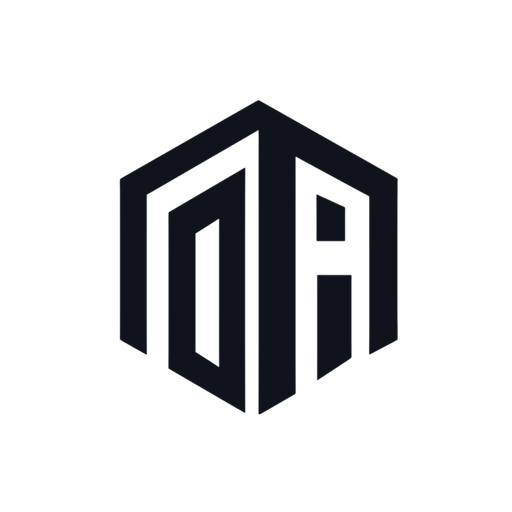 OpenAnalyst | Enterprise AI workforce platform for governed workflows across sales, service, finance, marketing, and operations. | https://www.openanalyst.com/ |

## Sales, SDR, and revenue agents

| # | Company | AI employee angle | Link |
|---:|---|---|---|
| 18 |  Artisan | Ava, an AI BDR / sales employee for outbound prospecting and meeting booking. | https://www.artisan.co/ |
| 19 |  11x | AI sales agents for outbound, inbound qualification, and account expansion across voice, email, social, and chat. | https://www.11x.ai/ |
| 20 | 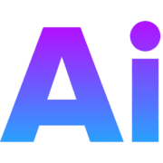 AiSDR | AI SDR agent for prospecting, outreach, follow-up, and booked meetings. | https://aisdr.com/ |
| 21 |  Qualified | Piper, Salesforce's AI SDR agent for inbound pipeline across website and email. | https://www.qualified.com/ |
| 22 |  Regie.ai | AI sales agents for prospecting, sequence generation, and rep workflows. | https://www.regie.ai/ |
| 23 |  Salesforge | Agent Frank, an AI SDR for outbound campaigns and follow-ups. | https://www.salesforge.ai/agent/frank |
| 24 |  Unify | GTM agents that research accounts, qualify signals, and trigger outreach plays. | https://www.unifygtm.com/ |
| 25 |  Clay | AI research and enrichment agents for outbound and GTM engineering workflows. | https://www.clay.com/ |
| 26 |  Nooks | AI sales assistant for dialing, prospecting, coaching, and sales workflow automation. | https://www.nooks.ai/ |
| 27 |  SalesCloser AI | Voice AI sales agents for discovery, qualification, and closing conversations. | https://salescloser.ai/ |
| 28 |  Bland | AI phone agents for sales calls, qualification, scheduling, and follow-up. | https://www.bland.ai/ |
| 29 |  1mind | AI sales agents for qualification, demos, objection handling, and customer expansion. | https://www.1mind.com/use-cases |
| 30 |  Amplemarket | Duo, AI sales agents for buying signals, prospect research, and multichannel outreach. | https://www.amplemarket.com/duo |
| 31 | 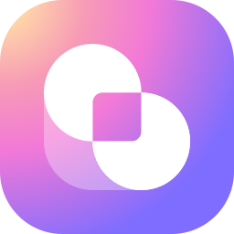 Bardeen | AI sales prospecting agents for web scraping, lead sourcing, qualification, and contact enrichment. | https://www.bardeen.ai/ |
| 32 |  Structurely / 21X | AI agents for inbound and outbound customer conversations, lead qualification, follow-up, and appointment booking across industries. | https://www.structurely.com/use-cases |

## Marketing, growth, and AI CMO agents

| # | Company | AI employee angle | Link |
|---:|---|---|---|
| 33 |  The AI CMO | Autonomous marketing agent for strategy, content, publishing, and analytics. | https://theaicmo.com/ |
| 34 | 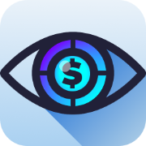 Finsi | AI CMO for ecommerce brands, focused on growth priorities and campaign execution. | https://www.finsi.ai/ |
| 35 |  Tixi | AI marketing teammates with human operators for campaign execution and ongoing growth workflows. | https://www.tixi.ai/ |
| 36 |  Maesto | Autonomous marketing agents for B2C campaign planning, launch, and optimization. | https://maesto.ai/ |
| 37 | Prago | Autonomous marketing agent that executes SEO, paid ads, social, content, and PR. | https://prago.io/ |
| 38 | Autom | AI marketing agent for social content, ad creatives, campaigns, and brand growth. | https://useautom.ai/ |
| 39 |  Jasper | Marketing AI agents that act as brand-aware marketing teammates. | https://www.jasper.ai/agents |
| 40 |  Copy.ai | Fullcast-owned GTM AI platform with agentic workflows for sales, marketing, and revenue operations. | https://www.copy.ai/ |
| 41 |  AirOps | AI agents and workflows for SEO, content, and growth operations. | https://www.airops.com/ |
| 42 |  Omneky | AI agents for ad creative generation, testing, and campaign optimization. | https://www.omneky.com/ |
| 43 |  Teamday | AI marketing team: an AI CMO sets one measurable goal and runs writer, SEO, and analytics agents; you approve every draft. | https://www.teamday.ai/ai-employees |
| 44 |  Hightouch | AI marketing agents for campaign planning, creative production, execution, and optimization. | https://hightouch.com/platform/agentic-marketing-platform |
| 45 |  Typeface | Marketing AI agents that plan, produce, review, and iterate on brand-aware campaigns. | https://www.typeface.ai/ |
| 46 |  Pulse | AI research moderator that conducts customer interviews and asks follow-up questions from a research brief. | https://pulsecorp.co/product/ai-moderation/ |

## Customer support, CX, and ecommerce agents

| # | Company | AI employee angle | Link |
|---:|---|---|---|
| 47 |  Sierra | AI agents for customer experience across chat, SMS, email, voice, and more. | https://sierra.ai/ |
| 48 |  Decagon | AI customer concierge agents for chat, email, and voice workflows. | https://decagon.ai/ |
| 49 | Ada | AI customer service agents that autonomously resolve support conversations. | https://www.ada.cx/ |
| 50 |  Intercom | Fin, Intercom's AI customer agent for service, sales, and ecommerce conversations. | https://fin.ai/ |
| 51 |  Zendesk | AI agents for automated customer service resolution inside Zendesk. | https://www.zendesk.com/service/ai/ai-agents/ |
| 52 |  Forethought | Zendesk-owned customer support agents for automated resolution, classification, and copilot workflows. | https://forethought.ai/ |
| 53 |  Maven AGI | Enterprise AI agent platform for support and customer experience. | https://www.mavenagi.com/ |
| 54 |  Parloa | AI agents for contact-center voice and chat automation. | https://www.parloa.com/ |
| 55 |  PolyAI | Voice AI agents for enterprise customer service calls. | https://poly.ai/ |
| 56 |  Cognigy | NiCE Cognigy, AI agents for enterprise contact centers and customer service automation. | https://www.cognigy.com/ |
| 57 |  Kore.ai | AI agents and virtual assistants for customer and employee service. | https://kore.ai/ |
| 58 |  Yellow.ai | AI agents for customer service, employee service, and contact-center automation. | https://yellow.ai/ |
| 59 |  Gorgias | AI Agent for ecommerce customer support automation. | https://www.gorgias.com/ai-agent |
| 60 |  Siena AI | Autonomous customer service agents for commerce brands. | https://www.siena.cx/ |
| 61 |  Workforce Wave | AI voice receptionist that answers inbound calls 24/7, books appointments, and captures leads for small and mid-sized businesses. | https://www.workforcewave.com/ |
| 62 |  Crescendo | Concierge, an AI resolution agent for customer service across voice and digital channels. | https://www.crescendo.ai/agents/concierge |
| 63 |  Dixa | Mim, an AI customer service agent for orders, refunds, returns, and support workflows. | https://www.dixa.com/ai-agent |

## Recruiting and HR agents

| # | Company | AI employee angle | Link |
|---:|---|---|---|
| 64 |  ConverzAI | AI recruiter and conversational recruiting automation. | https://www.converzai.com/ |
| 65 |  Paradox | Workday-owned candidate experience agent for conversational screening, scheduling, and high-volume hiring workflows. | https://www.paradox.ai/ |
| 66 |  Placewise AI | Autonomous AI recruiter for screening and first-round hiring workflows. | https://www.placewise.ai/ |
| 67 |  AiTento | AyeBo, a multi-agent AI recruiter for sourcing, screening, and hiring orchestration. | https://aitento.com/ |
| 68 |  Fountain | AI Recruiter for frontline and high-volume hiring. | https://www.fountain.com/airecruiter |
| 69 |  Alex | AI recruiter for resume screening, first-round interviews, candidate outreach, and scheduling. | https://www.alex.com/ |
| 70 | 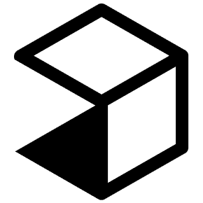 Juicebox | AI recruiting agents for candidate sourcing, evaluation, and personalized outreach. | https://juicebox.ai/agents |

## Finance, accounting, and back-office agents

| # | Company | AI employee angle | Link |
|---:|---|---|---|
| 71 |  Basis | AI agents for accounting firms across close, tax, and audit workflows; demo and waitlist access. | https://www.getbasis.ai/ |
| 72 |  Numeric | Accounting AI for close management, variance analysis, and accounting workflows. | https://www.numeric.io/ |
| 73 | 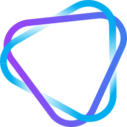 Vic.ai | Agentic finance partners and autonomous accounts payable workflows. | https://www.vic.ai/ |
| 74 |  Auditoria | AI-enabled finance agents for AR, AP, collections, and finance operations. | https://www.auditoria.ai/ |
| 75 | 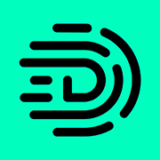 Digits | AI accounting agents built on an autonomous general ledger. | https://digits.com/ |
| 76 |  Nominal | Agentic AI platform that runs accounting workflows. | https://nominal.so/ |
| 77 |  Ledgent AI | Autonomous finance agents for AP, AR, close, and finance operations. | https://www.ledgent.ai/ |
| 78 |  ProcIndex | AI accounting team for AP, AR, reconciliation, close, and vendor workflows. | https://procindex.com/ |
| 79 |  Synthetic | AI bookkeeping agent for startup accounting workflows; waitlist access. | https://synthetic.ai/ |
| 80 |  Campfire | Ember, AI accounting teammates for reconciliation, AP, AR, accruals, and close preparation. | https://campfire.ai/ember |
| 81 | 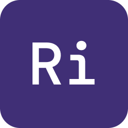 Rillet | Aura, accounting AI agents for recurring ledger, reconciliation, and close workflows. | https://www.rillet.com/product/aura-ai |

## Legal and compliance agents

| # | Company | AI employee angle | Link |
|---:|---|---|---|
| 82 |  Harvey | Legal AI agents for research, drafting, analysis, and practice-specific workflows. | https://www.harvey.ai/platform/agents |
| 83 |  Legora | Collaborative legal AI platform with agentic workflows for lawyers. | https://legora.com/ |
| 84 |  Spellbook | Legal AI agent for contract drafting, redlining, and multi-document review. | https://spellbook.com/ |
| 85 | Robin AI | Contract AI assistant for legal teams and contract review workflows. | https://www.robinai.com/ |
| 86 |  Thomson Reuters | CoCounsel Legal, AI for legal research, drafting, review, and professional workflows. | https://legal.thomsonreuters.com/en/products/cocounsel-legal |
| 87 |  LexisNexis | Lexis+ with Protégé, legal AI for research, drafting, analysis, and agentic workflows. | https://www.lexisnexis.com/en-us/products/lexis-plus-protege.page |
| 88 |  Luminance | Legal AI agents for contract review, negotiation, and legal process automation. | https://www.luminance.com/ |
| 89 |  Workday | Contracts Agent (formerly Evisort) for contract review, negotiation, and lifecycle management. | https://www.workday.com/en-us/ai-agents/finance/contracts.html |
| 90 |  Ironclad | AI-powered contract lifecycle management and legal workflow automation. | https://ironcladapp.com/ |
| 91 | 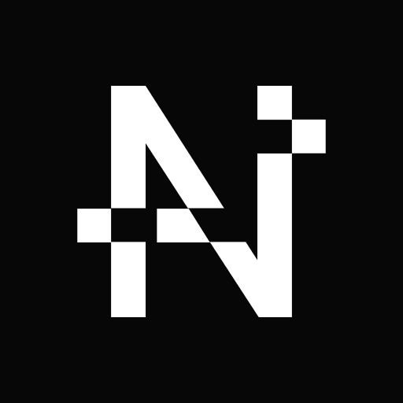 Norm Ai | Legal and compliance AI agents that encode laws, policies, and regulatory judgment. | https://www.norm.ai/ |
| 92 |  Eudia | Legal AI agents for research, review, analysis, and drafting against institutional standards. | https://www.eudia.com/platform/agents |
| 93 |  Eve | AI legal teammates for plaintiff case monitoring, records review, demand letters, and discovery. | https://www.eve.legal/use-cases/ai-agents-for-plaintiff-law |

## Software engineering, IT, and SRE agents

| # | Company | AI employee angle | Link |
|---:|---|---|---|
| 94 |  Cognition | Devin, an AI software engineer for coding, maintenance, migration, and incident tasks. | https://devin.ai/ |
| 95 |  Factory | Droids, AI software-engineering agents for SDLC tasks. | https://factory.com/ |
| 96 |  Cosine | AI coding agents powered by Lumen models for software engineering across CLI, desktop, and cloud. | https://cosine.sh/ |
| 97 | 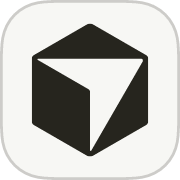 Cursor | Agentic coding environment for software development tasks. | https://cursor.com/ |
| 98 |  Replit | Replit Agent 4 for building and modifying software from natural-language requests. | https://replit.com/agent4 |
| 99 |  Lovable | AI software builder that turns prompts into applications. | https://lovable.dev/ |
| 100 |  StackBlitz | Bolt.new, an AI app-building agent in the browser. | https://bolt.new/ |
| 101 |  Vercel | v0, an AI agent for building and iterating on full-stack apps, deployment, and pull requests. | https://v0.app/ |
| 102 |  GitHub | Copilot coding agent for issue-to-PR software engineering work. | https://github.com/features/copilot |
| 103 |  CodeRabbit | AI code review agent for pull requests, IDEs, and CLI workflows. | https://www.coderabbit.ai/ |
| 104 |  Ciroos | AI SRE teammate for incident investigation, anomaly analysis, and autonomous operations. | https://ciroos.ai/ |
| 105 |  Resolve AI | AI SRE for alert triage, root-cause analysis, and incident investigation. | https://resolve.ai/product/ai-sre |
| 106 |  Augment Code | Cloud coding agents for tickets, code reviews, security fixes, and incident investigation. | https://www.augmentcode.com/product/cloud-agents |
| 107 |  Moveworks | ServiceNow-owned AI agents for IT help desk requests and cross-system employee workflows. | https://www.moveworks.com/us/en/solutions/ai-help-desk |
| 108 | OpenHands | Open-source software agents for issue resolution, code changes, CI repair, and maintenance. | https://www.openhands.dev/ |

## Security and SOC agents

| # | Company | AI employee angle | Link |
|---:|---|---|---|
| 109 | 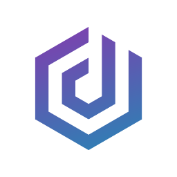 Dropzone AI | AI SOC analyst for autonomous alert investigation and threat hunting. | https://www.dropzone.ai/ |
| 110 | 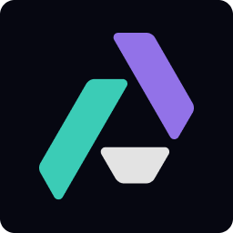 Prophet Security | AI SOC analyst for security alert investigation and response. | https://www.prophetsecurity.ai/ai-soc-analyst |
| 111 |  Torq | Socrates, an agentic AI SOC analyst and orchestrator for SecOps workflows. | https://torq.io/socrates/ |
| 112 |  XBOW | Autonomous AI penetration tester for offensive security work. | https://xbow.com/ |
| 113 |  Exaforce | Exabots, AI security agents for detection, alert triage, investigation, and response. | https://www.exaforce.com/exabots |
| 114 |  Simbian | AI security agents for SOC investigations, threat hunting, and penetration testing. | https://simbian.ai/ |

## Healthcare admin and clinical operations agents

| # | Company | AI employee angle | Link |
|---:|---|---|---|
| 115 |  Hippocratic AI | Healthcare voice AI agents for non-diagnostic patient-facing workflows. | https://hippocraticai.com/ |
| 116 |  Infinitus | Healthcare AI agents for patient, provider, and payer communications. | https://www.infinitus.ai/ |
| 117 |  Hyro | Healthcare AI agents for call centers, scheduling, patient access, and routing. | https://www.hyro.ai/ |
| 118 |  Tennr | Healthcare AI agents for document, referral, and back-office workflows. | https://www.tennr.com/ |
| 119 | 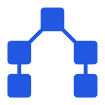 Assort Health | Healthcare AI agents for patient calls, scheduling, intake, referrals, and billing. | https://www.assorthealth.com/platform |
| 120 | 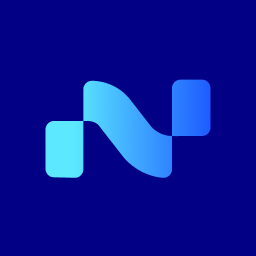 Notable | AI agent workforce for patient access, revenue cycle, and care operations. | https://www.notablehealth.com/ai-agent-workforce/overview |

## Logistics and supply-chain agents

| # | Company | AI employee angle | Link |
|---:|---|---|---|
| 121 |  Augment | Augie, an AI logistics teammate for freight operations from order entry through payment. | https://www.goaugment.com/ |
| 122 |  HappyRobot | AI logistics workers for load booking, rate negotiation, shipment tracking, and documents. | https://www.happyrobot.ai/solutions/industries/logistics-providers |
| 123 |  Raft | AI agents for freight forwarding, customs preparation, shipment operations, and invoices. | https://raft.ai/ |

## Real estate and property operations agents

| # | Company | AI employee angle | Link |
|---:|---|---|---|
| 124 |  EliseAI | AI property operations agents for leasing, resident communications, maintenance, and collections. | https://eliseai.com/platform-overview |
| 125 |  Funnel | Fenix, an AI teammate for leasing, resident requests, delinquency, and renewals. | https://funnelleasing.com/products |

## Insurance operations agents

| # | Company | AI employee angle | Link |
|---:|---|---|---|
| 126 |  FurtherAI | AI insurance teammates for underwriting review, policy comparison, audits, and claims workflows. | https://www.furtherai.com/ |
| 127 |  Liberate | Insurance AI agents for claims intake, policy servicing, sales, and customer communications. | https://www.liberate.ai/platform |
| 128 |  Sixfold | AI underwriting agents for submission review, risk assessment, and case recommendations. | https://www.sixfold.ai/ |

## Procurement and supplier operations agents

| # | Company | AI employee angle | Link |
|---:|---|---|---|
| 129 |  Omnea | Procurement AI agents for intake, reviews, approvals, supplier risk, and purchasing workflows. | https://www.omnea.co/ |
| 130 |  Pactum | Digital procurement workers for purchase intake, policy checks, sourcing, and supplier negotiations. | https://pactum.com/indirect-procurement |
| 131 |  Zip | AI procurement agents for purchase requests, approvals, vendor coordination, and contracts. | https://zip.com/capabilities/superagents |

<!-- LISTING:END -->

## Website

The repository includes a static, searchable directory in `index.html`, with a category landscape, instant browser-side search, category filters, sorting, and shareable filter URLs. It reads `data/companies.json`; there are no runtime dependencies or build tools. The Manrope font is self-hosted, with its license in `assets/fonts/OFL.txt`.

Preview locally:

```sh
python3 -m http.server 4185
```

Open `http://localhost:4185`. Use an HTTP server rather than opening `index.html` directly, so the browser can fetch the JSON data.

To deploy with GitHub Pages:

1. In the repository's **Settings → Pages**, select **GitHub Actions** as the source.
2. Merge the website files into `main`, or run **Deploy directory to GitHub Pages** from the Actions tab.
3. Open the URL reported by the deployment. For this repository, the default address is `https://akshitkrnagpal.github.io/awesome-ai-employees/`.

The workflow validates the generated data, packages only the website assets and JSON, and deploys them to Pages. All asset URLs are relative, so the site works under a repository path or a custom domain. When updating listings, edit the CSV and run `make generate` as usual.

Company icons are fetched from each company's website and cached in `assets/company-icons/`. The fetcher prefers a declared Apple touch icon, then the conventional `/apple-touch-icon.png`, then a declared favicon or `/favicon.ico`. If no usable icon is available, or an image fails to load, the directory shows the company's initials. The manifest records each image's original source and icon type. Browsing the directory only requests the cached files from this site.

The generated README tables use the same cached icons as 18-pixel images aligned with the text beside company names. Companies without a cached icon keep their plain-text names. Relative image paths keep the README portable between branches and forks.

Refresh the icons and README with `make icons`, or update one company with `python3 scripts/fetch_company_icons.py --company "Lindy"` followed by `make generate`. Review and commit the updated images, manifest, and README. Icon refreshes are optional and run separately from deployment, so a company website being unavailable won't block a Pages release.

## Data

The source of truth is [data/companies.csv](data/companies.csv). Generated exports:

- [README.md](README.md) listing sections
- [data/companies.json](data/companies.json)

Run `make generate` after editing the CSV. Run `make check` before committing.

## Contributing

This list is intentionally selective. A good submission includes the company name, product page, category, and one sentence explaining the AI employee or recurring-workflow angle.

Before submitting, check that the company has a public product page and that the AI worker positioning is visible there. See [CONTRIBUTING.md](CONTRIBUTING.md) for the full checklist.

## Roadmap

Planned additions before a wider public launch:

- Link health checks.
- Recent additions section.
- More evidence notes for each listing.

## License

This work is licensed under the [Creative Commons Attribution 4.0 International License](LICENSE).
